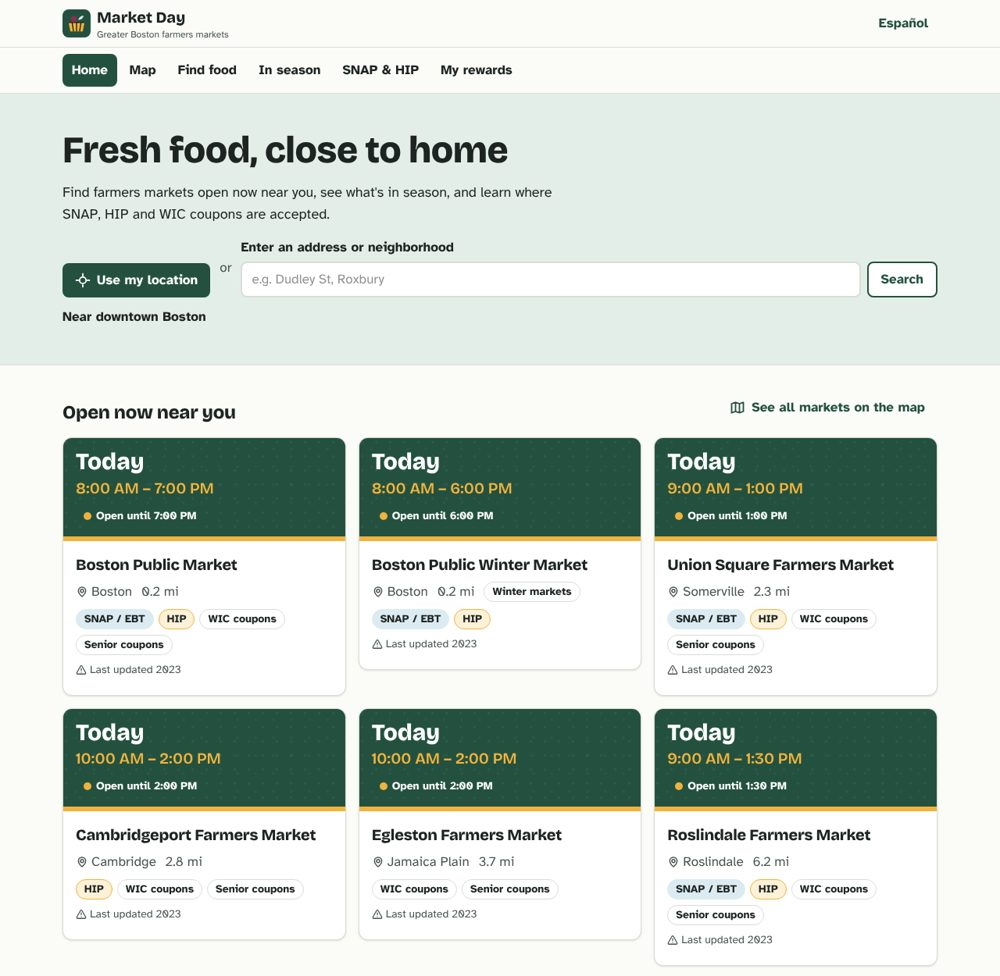
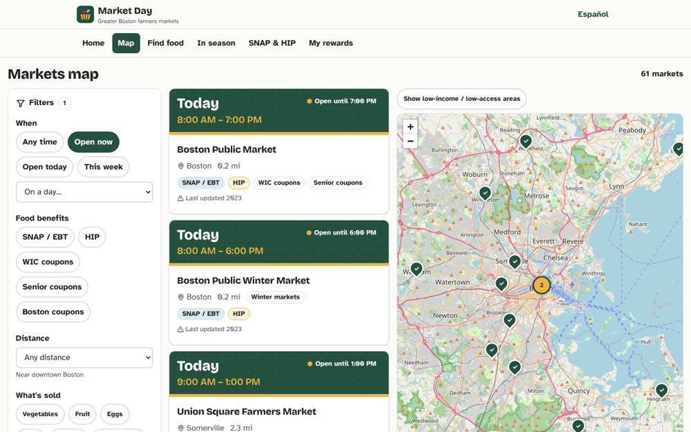
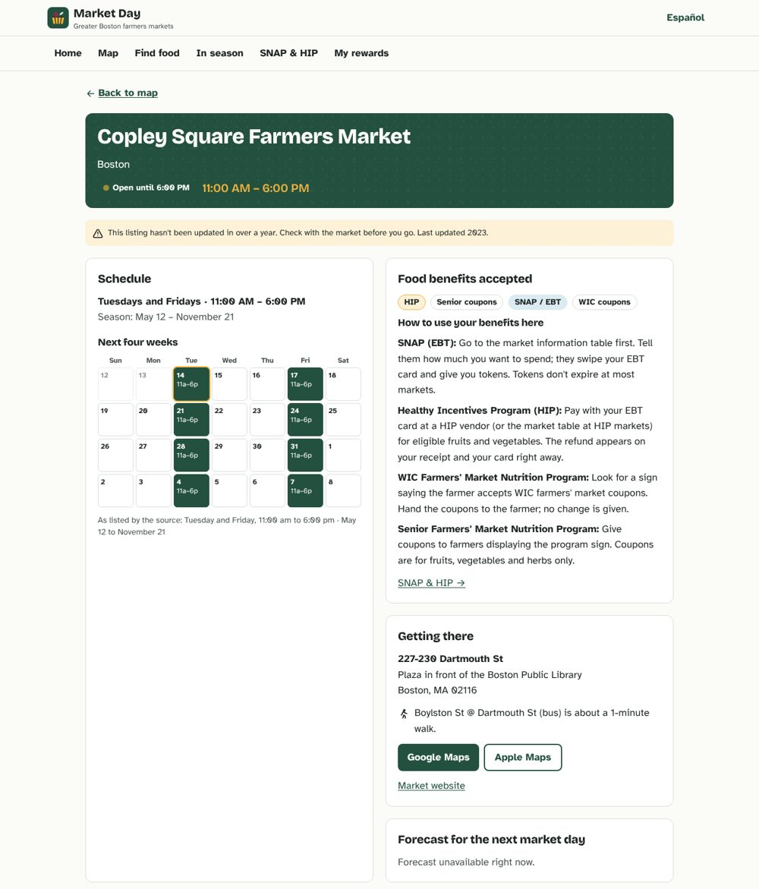
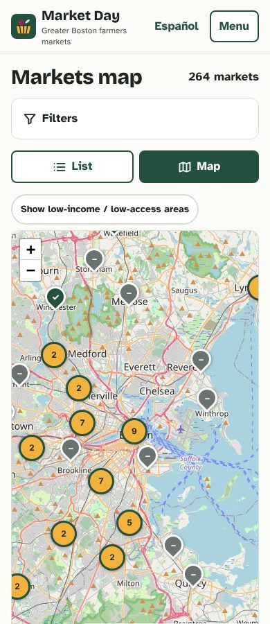

# Market Day Boston

Find farmers markets and farm stands across the contiguous US that are **open now**, see **what's in season**, and learn **where SNAP, HIP and WIC
coupons are accepted** — in English and Spanish, on a phone, at an outdoor market with weak signal. Vendors get a
transparent sustainability score and tools to post prices and end-of-day surplus; shoppers earn rewards for visiting.

**Live site:** https://25mkapadiya.github.io/HackHarvard/ (deployed by GitHub Actions on every push to `main` — see [Deploying](#deploying))

| Home                                                                     | Map                                                                     | Market page                                                                     | Phone                                              |
| ------------------------------------------------------------------------ | ----------------------------------------------------------------------- | ------------------------------------------------------------------------------- | -------------------------------------------------- |
|  |  |  |  |

> **Sample data.** Market locations, schedules and food-benefit participation are real public data (USDA,
> MassGIS/MDAR). **Vendors, products and prices shown for Greater Boston markets (the demo's sample vendors), vendor applications, and anything
> you save are invented sample data** for the demo, and the app labels them "Sample data" everywhere they appear.
> **Schedules may be out of date:** outside Massachusetts they come from USDA's National Farmers Market Directory,
> whose last public export is from 2014; Massachusetts uses the state's 2023-season list. Every market is flagged
> so people check before they go.

## Features

- **14,241 places to buy local food across the 48 contiguous states and DC** — 10,682 farmers markets and 3,559 farm
  stands and direct-selling farmers. Sources: USDA's national farmers market directory; the state's newer list in
  Massachusetts; and USDA's current SNAP retailer list, which confirms SNAP at listed markets and adds about 6,000
  SNAP-authorized markets and farms the directory misses. 8,581 locations take SNAP.
- **Open now, in each market's own time zone** — Eastern, Central, Mountain, Pacific and Arizona (no DST), including
  split states. Schedules are parsed into iCal RRULEs (97% of Massachusetts listings, 91% of USDA listings that give
  hours); the rest show the source's raw text and are left out of "open now" rather than guessed. DST-safe, with season
  boundaries, "no market on 7/4" exceptions and manager-posted closures.
- **Map + list** — clustered map (OpenStreetMap) with a "Whole US" button, keyboard-accessible list, filters for open
  now / today / this week / a weekday, market type, state, distance, food benefits, products, payment, winter and indoor markets,
  and sustainability. Filters live
  in the URL so views are shareable. An optional layer shades USDA low-income / low-access census tracts nationwide
  (45,141 tracts, loaded state by state as you pan).
- **Market pages** — schedule and a 4-week calendar, how to use SNAP/HIP/WIC there, the market's location (address
  and site), National Weather Service forecast for the next market day, vendors, sources with fetch dates, "Suggest a correction" (opens a GitHub issue), and a QR code for rewards check-in.
- **Find food** — "strawberries" → markets carrying them that are open in the next 7 days, plus whether they're in season.
- **In season** — month-by-month crop guide for 9 growing regions covering the mainland (55 crops, English and
  Spanish names), picked automatically from where you are.
- **SNAP & HIP guide** — plain-language guide in English and Spanish and a HIP calculator (monthly cap by household
  size, refund for a purchase). Program amounts live in `data/manual/programs.json` with a "last checked" date.
  Household size is only remembered if you tick the box.
- **Vendor portal** (`#/vendor`), **manager view** (`#/manager`), **rewards** (`#/rewards`) — demo mode: edit products,
  prices, stock and market attendance; post surplus; fill out the sustainability self-assessment and watch the score
  change; post a rain closure and see "open now" update; approve vendor applications; check in by QR for points and
  see estimated local dollars, food miles and CO₂e avoided (with the method spelled out).
- **Transparent sustainability score** — six categories, 100 points, rendered from the same code that computes it
  (`#/how-scores-work`, `src/lib/score/`). Self-reported items are marked until verified.
- **Works offline-ish** — installable PWA; app shell, data files and recently viewed map tiles are cached.

Tip: add `?now=2026-07-11T10:30` to any URL (e.g. `#/?now=2026-07-11T10:30`) to simulate a summer Saturday in Boston.

## How it works

GitHub Pages only serves static files, so there is no server or database at runtime. A **build-time pipeline**
collects public data, checks it, and commits static JSON that the browser loads; filtering, search, distance and
"open now" all run client-side.

```
 USDA national directory ┐
 MassGIS / MDAR markets  ┤
 USDA FNS SNAP retailers ┤
 USDA ERS food access    ┤   npm run data (Node, weekly in GitHub Actions)
 optional keyed sources* ├─▶ fetch ─▶ normalize ─▶ geocode ─▶ dedupe ─▶ enrich ─▶ validate ─▶ write
 (USDA LFP / MARS / NASS)┤      │        │                       │         │          │          │
 data/manual, data/seed ─┘   raw/ snapshot  RRULEs, names,      150 m + name  tracts, sample    zod     public/data/*.json
                             fallback       units, ZIPs         similarity   vendors                  → GitHub Pages
 * optional, need API keys
```

- Every fetch saves a raw snapshot in `data/raw/` and falls back to the latest snapshot if the source is down.
- `data/SOURCES.md` lists every source, license, fetch date and record count; `data/reports/dedupe.md` lists every
  merge for review; `data/reports/quality.md` lists schedules that couldn't be parsed.
- Writes (vendor portal, rewards, manager tools) go through a `Store` interface (`src/lib/store/`). The default
  `DemoStore` keeps everything in your browser's localStorage. A `SupabaseStore` is stubbed for later.
- Decisions not covered by the build plan are logged in `docs/DECISIONS.md`.

## Run it locally

```bash
npm ci
npm run dev            # http://localhost:5173/HackHarvard/
npm test -- --run      # unit tests (schedule parsing, open-now incl. DST, dedupe, units, score, HIP, filters, store)
npm run build && npm run test:e2e   # production build + Playwright smoke test
npm run lint
```

## Refresh the data

```bash
npm run data           # behind a proxy on Node ≥ 22.21: NODE_USE_ENV_PROXY=1 npm run data
```

Optional keys (copy `.env.example`; in CI, add them as repository secrets): `USDA_LFP_API_KEY` (USDA Local Food
Portal — also covers CSAs, on-farm markets and food hubs), `MARS_API_KEY` (USDA price benchmarks), `NASS_API_KEY`,
`CENSUS_API_KEY`. Without them those sources are recorded as `skipped`.
`.github/workflows/refresh-data.yml` runs the pipeline every Monday (and on demand), commits changed data to `main`,
and triggers a deploy.

## Deploying

`.github/workflows/deploy.yml` tests, builds with `VITE_BASE=/<repo>/`, and publishes `dist/` to GitHub Pages on every
push to `main`. One-time setup by a repo admin: **Settings → Pages → Source: GitHub Actions**, and
**Settings → General → Default branch: `main`**.

## Supabase mode (optional, not built yet)

Build with `VITE_BACKEND=supabase VITE_SUPABASE_URL=… VITE_SUPABASE_ANON_KEY=…` once `SupabaseStore`
(`src/lib/store/supabase.ts`) is implemented and `supabase/migrations/` define tables with Row Level Security on
every table (vendors edit only their rows; users see only their rewards; sales private). The anon key is safe to
ship only with RLS on. Never commit a service-role key. Until then the build falls back to demo mode.

## Project layout

```
scripts/        data pipeline (fetch/, normalize/, dedupe.ts, enrich.ts, validate.ts, pipeline.ts)
data/           raw/ snapshots · cache/ geocodes · manual/ curated JSON · seed/ SAMPLE vendors & prices · reports/
public/data/    generated static data served to the browser
src/            app/ routes/ components/ features/ lib/{schedule,geo,score,search,store} i18n/ types/
e2e/            Playwright smoke test
docs/           BUILD_PLAN.md · DECISIONS.md · screenshots/
```

## License

Code: MIT. Data: each source's own terms apply (see `data/SOURCES.md`) — MassGIS data with attribution to
MassGIS/MDAR, USDA data is public domain, map tiles © OpenStreetMap
contributors (ODbL). Sample data in `data/seed/` is invented.

## Open questions

The product questions from the original spec still stand (see [Open Questions](#13-open-questions) below). Building
the MVP added a few:

- **Fresher schedules.** Outside Massachusetts the newest public national data is USDA's 2014 directory export, and
  the state's own layer was last updated for 2023. A USDA Local Food Portal API key (`USDA_LFP_API_KEY`) would bring
  in USDA's current directory nationwide; the fetcher is written and waiting for one.
- **Real vendor data.** No public source lists who sells at which market or at what price; that has to come from
  market managers and vendors.
- **Boston coupon program.** No machine-readable list of participating markets was available, so none are tagged.

---

# Product requirements

The original requirements for the platform. The MVP above covers the consumer-facing parts nationwide, with demo
vendor data in Greater Boston.

### 1. Problem and Goals

Information about local food markets is spread across city websites, social media pages, paper flyers, and government directories that are often out of date. Because of this, consumers fall back on supermarkets, even when a nearby market sells fresher, lower-impact food and accepts their payment method or food-assistance benefits.

**Goals**

| Audience                  | Goal                                                                                                                             |
| ------------------------- | -------------------------------------------------------------------------------------------------------------------------------- |
| Consumers                 | Find nearby markets that are open now, carry what they need, accept their payment method, and match their sustainability values. |
| Vendors / Sellers         | Reach more customers, cut food waste, simplify logistics, and get rewarded for sustainable practices.                            |
| Market managers           | Manage vendor rosters, schedules, and program participation in one place.                                                        |
| Communities / Researchers | Use aggregated data to study food access, food deserts, and local food economies.                                                |

---

### 2. Core Data Domains

The platform is built around the data categories below. Each section lists the key fields and what they're used for.

#### 2.1 Geographic Distribution

Where markets and vendors are located, and who they serve.

- **Fields:** market name, street address, city, county, state, ZIP, latitude/longitude, location type (park, parking lot, church, school, farm, indoor hall), indoor/outdoor, accessibility notes (ADA, parking, transit stops nearby).
- **Derived data:** distance from user, travel time by walking/transit/bike/car, service radius, overlap with USDA food-desert / low-income low-access tracts, population density.
- **Features:** interactive map, "near me" search, clustering, heatmaps of market density vs. need, and route suggestions that cut down on driving.

#### 2.2 Operating Schedules

When markets are open, including changes by season.

- **Fields:** season start/end dates, day of week, open/close times, year-round flag, holiday closures, weather cancellations, special event days.
- **Features:** "open now" filter, calendar view, reminders/notifications, live status updates from managers (e.g., "closed due to rain"), and time zone handling.
- **Data concerns:** recurring rules (e.g., "every 2nd and 4th Saturday") should be stored in a standard format (iCal RRULE) rather than free text.

#### 2.3 Products

What is sold, and in which season.

- **Categories (expandable):** fruits, vegetables, herbs, meat, poultry, seafood, eggs, dairy, cheese, baked goods, honey, maple syrup, jams/preserves, nuts, grains/flour, beans, mushrooms, tofu/plant proteins, prepared foods, coffee/tea, wine/cider/beer, juice, flowers, plants/nursery, soap/body care, crafts, pet food, firewood.
- **Attributes:** certified organic, Certified Naturally Grown, pesticide-free, grass-fed, pasture-raised, free-range, non-GMO, regenerative, heirloom, halal/kosher, vegan, gluten-free, allergen info.
- **Seasonality:** a crop calendar by region so users can see what's in season and plan meals around it.
- **Features:** product search ("where can I find local strawberries this week?"), shopping lists matched to vendors, and seasonal recipe suggestions.

#### 2.4 Vendors

The farmers, producers, and artisans who sell at markets.

- **Fields:** business name, owner/contact, description, farm location, distance from farm to market (food miles), markets attended, products offered, certifications, photos, website/social links.
- **Sustainability profile:** growing practices, water use, packaging (plastic-free, compostable, reusable containers), renewable energy, waste practices, labor practices, and demographic badges such as small, beginning, BIPOC-owned, women-owned, or veteran-owned farm.
- **Features:** vendor pages, follow/favorite, reviews, verified badges, and "meet your farmer" stories.

#### 2.5 Payment Methods

How customers can pay.

- **Fields:** cash, credit/debit, mobile pay (Apple Pay, Google Pay, Venmo, Cash App), checks, market tokens/scrip, gift cards, and food-assistance benefits (see 2.6). Tracked **at both market and vendor level**, because individual vendors often differ from their market.
- **Features:** filter by payment method, an "accepts my benefits" filter, and optional in-app pre-orders and payments.

#### 2.6 Food-Access Programs

Federal, state, and local programs that make fresh food affordable.

- **Programs:** SNAP/EBT, WIC Farmers' Market Nutrition Program (FMNP), Senior Farmers' Market Nutrition Program (SFMNP), WIC Cash Value Benefit, Double Up Food Bucks and other SNAP incentive/matching programs (GusNIP-funded), Healthy Incentives Program (HIP, MA), produce prescription programs, and local voucher programs.
- **Fields:** programs accepted by each market/vendor, match rates and caps, eligibility notes, how to redeem (e.g., visit the info booth for tokens), and program funding status.
- **Features:** a benefits calculator ("$20 SNAP becomes $40 with Double Up"), plain-language guides, multilingual support, and a map of benefit-accepting markets.
- **Privacy:** never store a user's benefit status unless they choose to; filtering should work without an account.

#### 2.7 Vendor Logistics

How goods get from farm to market to consumer.

- **Fields:** stall assignment, booth size, power/water needs, load-in/load-out times, vehicle type, cold-chain capability, delivery radius, pickup points, minimum order size, wholesale availability, and inventory levels.
- **Features:**
  - Pre-order and pickup ("order by Thursday, pick up Saturday")
  - Shared delivery routes / aggregation through food hubs to cut trips and emissions
  - Surplus and unsold-inventory listings (end-of-day discounts, donations to food banks, gleaning)
  - Market manager tools: vendor applications, stall maps, fee collection, attendance tracking

#### 2.8 Prices

What things cost, and how that changes over time.

- **Fields:** product, unit (lb, each, bunch, dozen, pint), price, organic/conventional, date observed, source (vendor-entered, manager-reported, crowd-sourced).
- **Features:** price comparison across vendors and against supermarket averages, price trends over the season, budget planning, and "best value this week" highlights.
- **Data concerns:** units must be normalized for fair comparison, and stale prices should be flagged.

#### 2.9 Sales

Transaction data used for analytics and incentives (aggregated and access-controlled).

- **Fields:** sales volume by product/vendor/market/date, number of transactions, payment-method breakdown, benefit-program redemptions, foot traffic counts, and sell-through/waste rate.
- **Features:**
  - Vendor dashboards (top sellers, peak hours, demand forecasting)
  - Market reports (total sales, SNAP/incentive redemptions for grant reporting)
  - Community impact metrics (dollars kept in the local economy)
- **Privacy:** vendor sales data is private by default; only aggregated or anonymized data is shared publicly.

---

### 3. Additional Data Domains (Expansion)

| Domain                       | Description                                                                                                          |
| ---------------------------- | -------------------------------------------------------------------------------------------------------------------- |
| **Sustainability Metrics**   | Estimated food miles, CO₂e savings vs. conventional supply chains, packaging waste avoided, and food waste diverted. |
| **Events & Community**       | Cooking demos, live music, kids' activities, workshops, and seed swaps.                                              |
| **Amenities**                | Restrooms, seating, parking, bike racks, composting/recycling stations, and reusable-bag drop-off.                   |
| **Reviews & Ratings**        | Ratings for markets and vendors, with moderation tools.                                                              |
| **Weather**                  | Forecast integration so users know about closures and vendors can plan inventory.                                    |
| **Food Recovery**            | Partnerships with food banks, gleaning groups, and composting services.                                              |
| **Language & Accessibility** | Languages spoken by vendors and staff, and accessibility features of each site.                                      |

---

### 4. Sustainability & Incentive System

This is what makes the platform more than a directory: it rewards both consumers and sellers for sustainable behavior.

#### 4.1 For Consumers

- **Impact tracking:** a personal dashboard showing local dollars spent, estimated food miles and CO₂e saved, and plastic avoided.
- **Rewards / points:** earn points for shopping locally, bringing reusable bags/containers, buying in-season or "ugly" produce, buying end-of-day surplus, and walking/biking/taking transit to the market.
- **Redemption:** points can be redeemed for market tokens, vendor discounts, or donations to food-access programs.
- **Gamification:** streaks, seasonal challenges ("try 10 new local vegetables this summer"), badges, and community goals.

#### 4.2 For Vendors / Sellers

- **Sustainability score:** a clear score built from verified practices (certifications, packaging, food miles, waste diversion, benefit-program acceptance).
- **Visibility boosts:** higher-scoring vendors rank higher in search and earn "Sustainable Seller" badges.
- **Lower costs:** market managers can offer reduced stall fees for sustainable vendors or those accepting SNAP/WIC.
- **Demand signals:** pre-orders and demand forecasts help vendors bring the right amount and waste less.
- **Surplus channel:** a built-in way to sell or donate leftovers instead of throwing them away.
- **Grants & resources:** links to relevant grants (USDA FMPP, LFPP, GusNIP, EQIP) and technical assistance.

#### 4.3 Integrity

- Verification for self-reported claims (certificate upload, manager approval, periodic audits).
- Anti-fraud controls on rewards (rate limits, transaction verification, receipt/QR scanning).
- A public, transparent scoring method so vendors know how to improve.

---

### 5. Users & Roles

| Role                                | Capabilities                                                                                                               |
| ----------------------------------- | -------------------------------------------------------------------------------------------------------------------------- |
| **Guest**                           | Browse map, search markets/products, filter by schedule/payment/programs.                                                  |
| **Consumer (registered)**           | Favorites, shopping lists, pre-orders, reviews, rewards, impact dashboard, notifications.                                  |
| **Vendor**                          | Manage profile, products, prices, inventory, markets attended, pre-orders, sales dashboard, sustainability profile.        |
| **Market Manager**                  | Manage market info and schedules, approve vendors, stall maps, announcements, program participation, market-level reports. |
| **Admin**                           | Data moderation, verification, import pipelines, user management, analytics.                                               |
| **Partner / Researcher** (optional) | Read-only access to anonymized, aggregated datasets via API.                                                               |

---

### 6. Functional Requirements

#### Consumers

- [ ] Map and list views of markets with search and filters (location, open now, products, payment methods, food-access programs, sustainability attributes)
- [ ] Market detail pages (schedule, vendors, products, amenities, programs, directions)
- [ ] Vendor detail pages (products, prices, practices, markets attended)
- [ ] Product search across all vendors/markets
- [ ] Seasonal produce guide
- [ ] Favorites, shopping lists, and notifications (market opening, product availability, closures)
- [ ] Pre-order and pickup flow
- [ ] Rewards and personal impact dashboard
- [ ] Benefits guide and calculator

#### Vendors

- [ ] Onboarding and profile management
- [ ] Product catalog, pricing, and inventory updates (fast, mobile-friendly, ideally usable at the stall)
- [ ] Market attendance calendar
- [ ] Order management for pre-orders
- [ ] Sales and demand analytics
- [ ] Sustainability self-assessment and verification uploads
- [ ] Surplus/donation listings

#### Market Managers

- [ ] Market profile and schedule management (including one-off closures)
- [ ] Vendor application and approval workflow
- [ ] Stall layout and assignment
- [ ] Program participation (SNAP, WIC, incentives) and redemption reporting
- [ ] Announcements and event posting

#### Data & Admin

- [ ] Bulk import from public data sources (see Section 8)
- [ ] De-duplication and data quality checks (geocoding validation, stale-record flags)
- [ ] Crowd-sourced corrections with a moderation queue
- [ ] Public API for read access to non-sensitive data

---

### 7. Non-Functional Requirements

- **Mobile-first:** most consumers and vendors will use the platform on phones, often outdoors with weak signal; support offline caching / PWA.
- **Accessibility:** WCAG 2.1 AA compliance, screen-reader support, high-contrast mode.
- **Localization:** multilingual UI (at minimum English and Spanish; expand based on community needs).
- **Performance:** map and search results in under 2 seconds on a 4G connection.
- **Privacy & security:** minimal data collection; encrypted storage of personal data; no sale of user data; benefit usage is never exposed. Follow applicable laws (CCPA, state privacy laws) and the USDA FNS rules on SNAP retailer data.
- **Payments compliance:** use PCI-DSS compliant processors; SNAP/EBT online processing requires FNS authorization and an approved third-party processor.
- **Data freshness:** schedules and prices show a "last updated" timestamp; stale data is flagged automatically.
- **Scalability:** start at a city/region level and design the data model to scale nationally.
- **Reliability:** graceful degradation if third-party services (maps, weather, payments) are unavailable.

---

### 8. Data Sources & Collection

| Source                                                                                                      | Data Provided                                                    |
| ----------------------------------------------------------------------------------------------------------- | ---------------------------------------------------------------- |
| [USDA AMS National Farmers Market Directory / Local Food Directories](https://www.usdalocalfoodportal.com/) | Market locations, schedules, products, payment methods, programs |
| USDA FNS SNAP Retailer Locator                                                                              | SNAP-authorized farmers markets and direct marketing farmers     |
| USDA Food Access Research Atlas                                                                             | Low-income / low-access census tracts                            |
| USDA NASS (Census of Agriculture, Quick Stats)                                                              | Regional farm and production data                                |
| USDA AMS Market News                                                                                        | Wholesale and retail price benchmarks                            |
| State agriculture departments & market associations                                                         | Regional market listings, certified market lists                 |
| Fair Food Network / Double Up Food Bucks                                                                    | Incentive program participation                                  |
| Vendor & manager self-reporting                                                                             | Products, prices, inventory, practices                           |
| Crowd-sourcing                                                                                              | Corrections, photos, prices, reviews                             |
| Open data (OpenStreetMap, Census/ACS)                                                                       | Geocoding, demographics, transit                                 |

**Collection pipeline:** ingest → normalize (units, categories, addresses) → geocode → de-duplicate → validate → publish, with a scheduled refresh and change history.

---

### 9. Proposed Data Model (High Level)

```
Market ─┬─< MarketSchedule
        ├─< MarketVendor >── Vendor ─┬─< VendorProduct >── Product ── ProductCategory
        ├─< MarketPaymentMethod      ├─< VendorPaymentMethod
        ├─< MarketProgram >── Program├─< VendorCertification
        ├─< Event                    ├─< SustainabilityProfile
        └─< Amenity                  └─< Inventory / Price (time series)

User ─┬─< Favorite
      ├─< Order ──< OrderItem >── VendorProduct
      ├─< RewardTransaction
      └─< Review

Sale (aggregated) ── Vendor, Market, Product, PaymentMethod, Date
```

**Key entities**

- `Market`: id, name, address, geo (point), location_type, indoor_outdoor, website, contact, manager_id
- `MarketSchedule`: market_id, season_start, season_end, rrule, open_time, close_time, exceptions
- `Vendor`: id, name, description, farm_geo, contact, sustainability_score
- `Product` / `ProductCategory`: standardized taxonomy with attributes
- `Price`: vendor_product_id, unit, amount, observed_at, source
- `Program`: id, name (SNAP, WIC FMNP, Double Up, …), match_rate, cap, description
- `PaymentMethod`: id, name, type
- `Sale`: vendor_id, market_id, date, product_category, amount, transactions, payment_method, program
- `RewardTransaction`: user_id, action, points, verified_by, created_at

---

### 10. Suggested Tech Stack (Flexible)

> The MVP replaced the server/database rows below with a static build-time pipeline — see [How it works](#how-it-works).

| Layer          | Options                                                      |
| -------------- | ------------------------------------------------------------ |
| Frontend (web) | React / Next.js, Tailwind CSS                                |
| Mobile         | React Native / Expo, or a PWA                                |
| Maps           | Mapbox GL, Leaflet + OpenStreetMap, or Google Maps           |
| Backend / API  | Node.js (Express/NestJS) or Python (FastAPI/Django)          |
| Database       | PostgreSQL + PostGIS (geospatial queries)                    |
| Auth & storage | Supabase / Firebase / Auth0                                  |
| Search         | PostgreSQL full-text search, Meilisearch, or Algolia         |
| Payments       | Stripe / Square (cards); FNS-approved processor for SNAP/EBT |
| Analytics      | Metabase / Superset dashboards; scheduled ETL jobs           |
| Hosting        | Vercel / Netlify (frontend), Render / Fly.io / AWS (backend) |

---

### 11. Hackathon MVP Scope

A realistic first version to build quickly:

1. **Import** USDA farmers market data for one region (e.g., Massachusetts / Greater Boston) into PostgreSQL + PostGIS.
2. **Map + list view** with filters: open now, products, payment methods, SNAP/WIC/HIP acceptance.
3. **Market & vendor detail pages** with schedules, products, and sample prices.
4. **Vendor portal (basic):** sign up, edit products and prices, mark attendance.
5. **Sustainability score v1:** based on a small set of self-reported practices and food miles.
6. **Consumer rewards v1:** check-in at a market (QR code) to earn points, plus a simple impact dashboard.

**Stretch goals:** pre-orders, surplus listings, a benefits calculator, multilingual UI, demand forecasting, and seasonal recipe suggestions.

---

### 12. Success Metrics

- Number of markets and vendors listed, and how fresh their data is
- Monthly active consumers and repeat visits
- Pre-orders / transactions facilitated
- SNAP/WIC/incentive dollars redeemed through listed markets
- Estimated CO₂e and food waste avoided
- Vendor revenue growth and retention
- Share of users in low-income / low-access areas

---

### 13. Open Questions

- How will vendor-reported sustainability claims be verified at scale?
- Who funds the rewards (markets, grants, sponsors, vendor fees)?
- Will the platform process payments directly, or only link out to existing systems?
- How do we keep data fresh when many small vendors have limited time or tech access?
- What data-sharing agreements are needed with markets and program administrators?

## Contributing

1. Create a feature branch.
2. Run `npm test -- --run` and `npm run lint` before opening a pull request.
3. Data changes: edit `data/manual/` or the pipeline, run `npm run data`, and commit the regenerated files.
